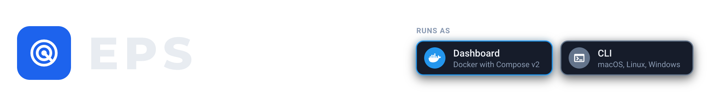
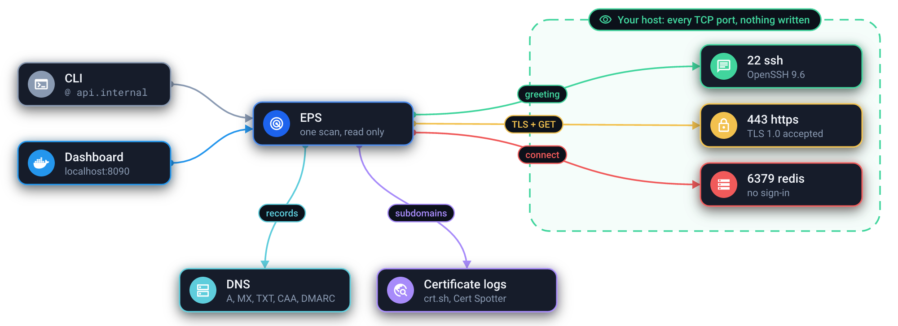
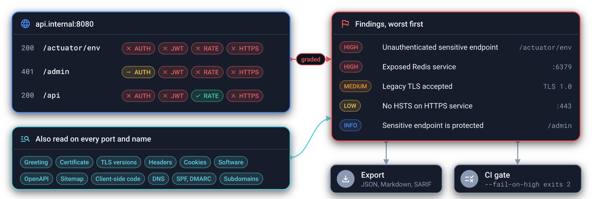

<picture><source media="(prefers-color-scheme: light)" srcset="docs/images/header-light.png"></picture>

<a href="docs/how-it-works.md"><picture><source media="(prefers-color-scheme: light)" srcset="docs/images/how-it-works-light.png"></picture></a>

<a href="docs/cli.md#reading-the-report"><picture><source media="(prefers-color-scheme: light)" srcset="docs/images/what-it-reports-light.png"></picture></a>

## Install

Dashboard (Docker with Compose v2):

```sh
curl -fsSL https://raw.githubusercontent.com/KrisPowers/eps/main/compose.yaml -o compose.yaml
docker compose up -d
```

CLI on Linux and macOS:

```sh
curl -fsSL https://raw.githubusercontent.com/KrisPowers/eps/main/install.sh | sh
```

CLI on Windows (PowerShell):

```powershell
irm https://raw.githubusercontent.com/KrisPowers/eps/main/install.ps1 | iex
```

Homebrew, prebuilt binaries and building from source are in the
[CLI guide](docs/cli.md#install).

## Get started

Open <http://localhost:8090> and type a host into the search bar, or in a
terminal:

```sh
@ 192.168.1.10
```

The [dashboard](docs/dashboard.md) and the [CLI](docs/cli.md) guides cover the
rest. Scan only hosts you own or are authorized to assess.
